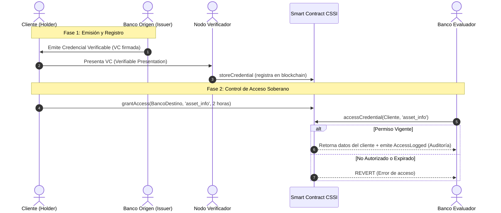

# 🎓 Guía Definitiva y Guion para la Exposición: Framework CSSI

> **Artículo base:** *A Self-Sovereign Identity Blockchain Framework for Access Control and Transparency in Financial Institutions*  
> **Autores:** Ou, Chen & Lin (*Cryptography* 2025, 9, 9)  
> **Objetivo:** Demostrar en vivo cómo un usuario ejerce soberanía sobre sus datos financieros mediante identidad descentralizada (SSI) y contratos inteligentes en Ethereum.

---

## 1. Contexto Teórico para Abrir tu Exposición

### El Problema que Resuelve el Paper
En el sistema bancario tradicional, las instituciones comparten información crediticia y de activos a través de intermediarios centralizados (burós de crédito tradicionales) o mediante canales privados. Esto presenta tres problemas:
1. **Pérdida de soberanía:** El cliente no controla quién ve sus datos ni por cuánto tiempo.
2. **Riesgo de fuga masiva:** Bases de datos centralizadas son blancos de ciberataques.
3. **Falta de trazabilidad auditable:** El usuario difícilmente puede auditar cada vez que un banco consultó su información.

### La Solución: Framework CSSI
El framework propone una arquitectura de **Identidad Autosoberana (SSI)** sobre Blockchain compuesta por 4 actores:
- **Holder (Cliente):** Dueño de los datos y de la identidad (`did:ethr:0x...`).
- **Issuer (Emisor / Banco de origen):** Emite una Credencial Verificable (VC) firmada digitalmente con datos de activos o crédito.
- **Verifier (Nodo validador):** Valida la firma del emisor y registra la credencial en el Smart Contract.
- **Verifier/Relying Party (Institución evaluadora):** Solo puede acceder a los datos si el cliente le otorgó un permiso vigente.



---

## 2. Preparación Previa a tu Exposición (Checklist 5 minutos antes)

Antes de proyectar tu pantalla:

- [ ] **Terminal 1 abierta y corriendo:**
  ```powershell
  cd C:\Users\USER\.gemini\antigravity\scratch\cssi
  npx hardhat node
  ```
- [ ] **Terminal 2 ejecutada:**
  ```powershell
  cd C:\Users\USER\.gemini\antigravity\scratch\cssi
  npx hardhat run scripts/deploy.js --network localhost
  npx hardhat run scripts/seed.js --network localhost
  npx serve frontend
  ```
- [ ] **Navegador abierto en:** `http://localhost:3000`
- [ ] **MetaMask conectado a:** `Hardhat Local` (`http://127.0.0.1:8545`, Chain ID: `31337`).
- [ ] **Cuentas identificadas en MetaMask:**
  - `laboratorio` (Cliente / Holder): `0x90F79bf6EB2c4f870365E785982E1f101E93b906`
  - `embouteillur` (Institución Financiera): `0x15d34AAf54267DB7D7c367839AAf71A00a2C6A65`

---

## 3. Guion de Demostración en Vivo (Paso a Paso)

### Acto 1: Explicar la Arquitectura y el Registro (1 minuto)
- **Qué mostrar:** Brevemente la terminal o diapositiva donde se muestra que `BancoX` (Issuer) emitió un VC firmado con clave asimétrica y el Verificador lo persistió en el Smart Contract `CSSI.sol`.
- **Qué decir:**
  > *"Hemos replicado el ecosistema del paper utilizando la red de desarrollo Hardhat y ethers.js. Las credenciales de activos y crédito ya fueron emitidas conforme al estándar W3C y registradas en el contrato inteligente con sus respectivos hashes criptográficos."*

---

### Acto 2: El Cliente Otorga Acceso Temporal (Algoritmo 1 del Paper)
- **Acción en pantalla:**
  1. En MetaMask, selecciona la cuenta **`laboratorio`** (Cliente).
  2. En `http://localhost:3000`, haz clic en **"Conectar MetaMask"**.
  3. Muestra que arriba dice `Cuenta activa: 0x90F7...`.
  4. En la sección **"Dar o revocar permiso"**:
     - Pega la dirección de la institución (`0x15d34AAf54267DB7D7c367839AAf71A00a2C6A65`).
     - Tipo: Selecciona **`Información de activos (asset_info)`**.
     - Horas de acceso: Coloca **`2`**.
     - Haz clic en **"Autorizar"**.
  5. Confirma la transacción en la ventana emergente de MetaMask.
- **Resultado que aparece:**
  ```text
  Acceso concedido por 2 hora(s).
  ```
- **Qué decir al jurado:**
  > *"Aquí vemos el Algoritmo 1 en acción: el cliente es quien decide explícitamente compartir únicamente su información de activos (no su historial crediticio) y define una ventana de validez estricta de 2 horas. La autorización queda registrada de forma inmutable en el mapping `access` del contrato."*

---

### Acto 3: La Institución Consulta y se Genera Auditoría (Algoritmo 2 del Paper)
- **Acción en pantalla:**
  1. Abre MetaMask y cambia a la cuenta **`embouteillur`** (Institución financiera).
  2. En la sección **"Institución financiera"**:
     - Dirección del cliente: Pega `0x90F79bf6EB2c4f870365E785982E1f101E93b906`.
     - Tipo: Selecciona **`asset_info`**.
     - Haz clic en **"Consultar"**.
  3. Confirma la transacción en MetaMask.
- **Resultado que aparece en pantalla:**
  ```text
  Institución: BancoX
  Datos: {"balance":25000,"realEstate":"Casa 120m2"}
  Issuer: 0x70997970C51812dc3A010C7d01b50e0d17dc79C8
  ```
- **Qué decir al jurado:**
  > *"El banco solicita los datos y el contrato inteligente verifica tres cosas en orden: 1) que la credencial exista, 2) que el cliente haya otorgado permiso a esta dirección, y 3) que el tiempo no haya expirado. Como todo es válido, retorna los datos y además dispara el evento `AccessLogged`, dejando un rastro de auditoría transparente que no se puede borrar ni alterar."*

---

### Acto 4: Demostración de Seguridad y Control de Errores (Las Figuras 20 a 22 del Paper)

Muestra cómo el contrato rechaza accesos indebidos:

#### Caso A: Acceso No Autorizado (Privacidad granular)
- **Acción:** Estando en la cuenta de la Institución, cambia el selector a **`credit_info`** y haz clic en **"Consultar"**.
- **Resultado:**
  ```text
  Acceso denegado: Customer does not allow
  ```
- **Qué decir:**
  > *"El banco intenta consultar el historial crediticio del cliente, pero el Smart Contract lo rechaza de inmediato con el error exacto 'Customer does not allow', porque el cliente solo autorizó activos, demostrando el principio de mínimo privilegio."*

#### Caso B: Revocación Anticipada
- **Acción:** Cambia en MetaMask a `laboratorio`, dale a **"Revocar"** para `asset_info`. Luego vuelve al banco y consulta `asset_info`.
- **Resultado:**
  ```text
  Acceso denegado: Customer does not allow
  ```
- **Qué decir:**
  > *"El cliente tiene soberanía total. Si decide revocar el acceso antes de las 2 horas, el contrato actualiza el periodo a cero y el banco pierde el acceso al instante."*

#### Caso C: Expiración Temporal (Time-lock)
- **Acción:** Otorga permiso de 1 hora. Luego en la Terminal 2 ejecuta:
  ```powershell
  npx hardhat run scripts/advance-time.js --network localhost
  ```
  Vuelve al navegador y dale a **Consultar**.
- **Resultado:**
  ```text
  Acceso denegado: The access period is expired
  ```
- **Qué decir:**
  > *"Hemos avanzado el reloj de la blockchain en 2 horas mediante llamadas RPC `evm_increaseTime`. El contrato detecta que el timestamp actual superó el límite concedido y bloquea el acceso automáticamente sin necesidad de intervención manual."*

---

## 4. Preguntas Difíciles del Jurado y Respuestas Clave

| Pregunta probable del Jurado | Respuesta técnica y precisa |
| :--- | :--- |
| **1. ¿Por qué en el contrato los datos se guardan en texto claro en `uri`?** | *"Es una limitación funcional del diseño original del paper. El paper asume datos 'desidentificados'. Sin embargo, en un entorno de producción real, este campo debe almacenar hashes de IPFS o datos cifrados con la clave pública de la institución (cifrado asimétrico ECIES o proxy re-encryption) para garantizar confidencialidad en almacenamiento público."* |
| **2. ¿Qué pasó con las pruebas de conocimiento cero (zk-SNARKs)?** | *"El paper menciona conceptualmente zk-SNARKs en su introducción, pero en la sección de implementación y resultados no implementó ningún circuito ZK. En nuestro prototipo replicamos con fidelidad la implementación real del paper utilizando firmas digitales criptográficas estándar secp256k1."* |
| **3. Encontraron algún error o discrepancia en el paper?** | *"Sí, encontramos un bug en el pseudocódigo del Algoritmo 2 del paper: los autores escribieron la condición `CurrentTime > Period` para permitir el acceso, lo cual está invertido (significaría permitir el acceso solo cuando ya venció). En nuestra implementación corregimos la condición a `block.timestamp <= until`."* |
| **4. ¿Quién controla qué instituciones son Issuers o Verifiers?** | *"En este prototipo lo administra una cuenta `admin`. Para llevar esto a producción bancaria, este rol de gobernanza debería recaer en un consorcio regulador (como la Superintendencia de Banca o Banco Central) o una DAO multi-firma."* |
| **5. ¿Se midió el costo de gas de estas operaciones?** | *"El paper original no midió consumo de gas ni latencia; se limitó a validar la funcionalidad lógica. En nuestra suite de tests unitarios (`npx hardhat test`) los 5 casos de prueba pasan en milisegundos en red local."* |

---

## 5. Resumen de Cierre de tu Exposición

> *"En conclusión, hemos implementado y validado funcionalmente el framework CSSI propuesto por Ou, Chen y Lin (2025). Hemos comprobado que la combinación de Identidad Autosoberana (SSI) con Contratos Inteligentes resuelve de forma práctica los problemas de intermediación, otorgando al usuario el control soberano sobre la exposición temporal y granular de sus credenciales financieras, con un registro de auditoría transparente y resistente a la censura."*
