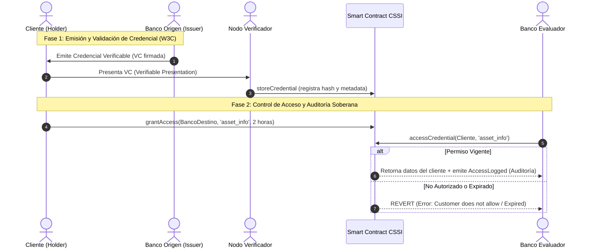

# 🛡️ CSSI: Self-Sovereign Identity Blockchain Framework

Implementación y réplica completa del prototipo presentado en el artículo científico:
> **"A Self-Sovereign Identity Blockchain Framework for Access Control and Transparency in Financial Institutions"**  
> *Autores:* C. Ou, Y. Chen y C. Lin (*Cryptography* 2025, 9, 9).  
> *DOI / Cita:* Cryptography 2025, 9(1), 9; https://doi.org/10.3390/cryptography9010009

---

## 📌 1. Resumen y Arquitectura del Sistema

El framework propone una arquitectura de **Identidad Autosoberana (SSI)** sobre Blockchain para instituciones financieras. Resuelve el problema del intercambio de datos bancarios sin intermediarios centralizados y garantizando que el usuario tenga control granular sobre:
- **A quién autoriza** (institución evaluadora de crédito o préstamo).
- **Qué información comparte** (activos financieros o score crediticio).
- **Durante cuántas horas** (bloqueo temporal inmutable).
- **Auditoría inmutable** (cada acceso emite un evento rastreable en la blockchain).

### Flujo del Framework (Diagrama de Secuencia)



---

## 🚀 2. Ejecución Rápida en Local

### 1. Iniciar el Nodo Blockchain (Terminal 1)
```bash
npx hardhat node
```
*Deja esta terminal abierta.* Correrá la red local en `http://127.0.0.1:8545` con 20 cuentas precargadas con 10,000 ETH de prueba.

### 2. Desplegar Contrato y Sembrar Credenciales (Terminal 2)
```bash
# 1. Despliega el contrato y asigna roles de Issuer y Verifier
npx hardhat run scripts/deploy.js --network localhost

# 2. Emite credenciales de BancoX y BuroY y las registra en la blockchain
npx hardhat run scripts/seed.js --network localhost
```

### 3. Levantar la Interfaz Web (Terminal 2 o 3)
```bash
npx serve frontend
```
Abre en tu navegador: **`http://localhost:3000`**

### 4. Configuración de MetaMask
1. Agrega una red manualmente:
   - **Nombre de red:** `Hardhat Local`
   - **Nueva URL de RPC:** `http://127.0.0.1:8545`
   - **Identificador de cadena (Chain ID):** `31337`
   - **Símbolo de moneda:** `ETH`
2. Utiliza las cuentas de prueba:
   - **Cliente (`laboratorio` / Cuenta #3):** `0x90F79bf6EB2c4f870365E785982E1f101E93b906`
   - **Institución Financiera (`embouteillur` / Cuenta #4):** `0x15d34AAf54267DB7D7c367839AAf71A00a2C6A65`

---

## 🎤 3. Guion de Demostración y Puesta a Prueba para Exposición

Sigue este guion paso a paso durante tu presentación en vivo:

### Acto 1: El Cliente Autoriza Acceso Temporal (Algoritmo 1)
1. En MetaMask selecciona la cuenta del **Cliente** (`laboratorio` - `0x90F7...`).
2. En la página web haz clic en **"Conectar MetaMask"**.
3. En la sección **"Dar o revocar permiso"**:
   - **Dirección de la institución:** `0x15d34AAf54267DB7D7c367839AAf71A00a2C6A65`
   - **Tipo:** `Información de activos (asset_info)`
   - **Horas de acceso:** `2`
   - Haz clic en **Autorizar** y confirma en MetaMask.
4. **Resultado esperado:**
   ```text
   Acceso concedido por 2 hora(s).
   ```
> 💬 **Qué decir:** *"El cliente ejerce soberanía sobre su información financiera. Decide compartir únicamente sus activos (no su récord de crédito) con un banco específico y por un tiempo acotado de 2 horas."*

---

### Acto 2: La Institución Consulta y Audita (Algoritmo 2)
1. Cambia en MetaMask a la cuenta de la **Institución** (`embouteillur` - `0x15d3...`).
2. En la sección **"Institución financiera"**:
   - **Dirección del cliente:** `0x90F79bf6EB2c4f870365E785982E1f101E93b906`
   - **Tipo:** `asset_info`
   - Haz clic en **Consultar** y confirma la transacción de auditoría en MetaMask.
3. **Resultado esperado:**
   ```text
   Institución: BancoX
   Datos: {"balance":25000,"realEstate":"Casa 120m2"}
   Issuer: 0x70997970C51812dc3A010C7d01b50e0d17dc79C8
   ```
> 💬 **Qué decir:** *"El contrato verifica existencia, autorización y vigencia temporal. Al ser válido, entrega los datos y dispara un evento inmutable `AccessLogged`, dejando constancia transparente en la blockchain de quién consultó qué dato."*

---

### Acto 3: Validación de Seguridad y Casos de Error (Figuras 20 a 22 del Paper)

#### ❌ Caso A: Acceso No Autorizado (Principio de Mínimo Privilegio)
- Estando en la cuenta de la Institución, selecciona **`credit_info`** y haz clic en **Consultar**.
- **Resultado esperado:**
  ```text
  Acceso denegado: Customer does not allow
  ```
> 💬 **Qué decir:** *"El banco intenta consultar datos crediticios para los cuales el cliente no otorgó permiso; el contrato inteligente rechaza la transacción de forma inmediata."*

#### ❌ Caso B: Revocación Anticipada
- Cambia a la cuenta del Cliente, haz clic en **Revocar** sobre `asset_info`.
- Vuelve a la cuenta de la Institución y consulta `asset_info`.
- **Resultado esperado:**
  ```text
  Acceso denegado: Customer does not allow
  ```
> 💬 **Qué decir:** *"El cliente puede retirar el consentimiento en cualquier momento. El periodo se establece en cero y el acceso queda revocado al instante."*

#### ❌ Caso C: Expiración Temporal Automática (Time-lock)
- Concede acceso por 1 hora. Luego en la terminal avanza el reloj de la EVM:
  ```bash
  npx hardhat run scripts/advance-time.js --network localhost
  ```
- Haz clic de nuevo en **Consultar** como Institución.
- **Resultado esperado:**
  ```text
  Acceso denegado: The access period is expired
  ```
> 💬 **Qué decir:** *"El contrato inteligente valida criptográficamente el timestamp del bloque. Al haber transcurrido el tiempo pactado, el permiso expira sin requerir acciones adicionales."*

---

## 🧪 4. Pruebas Unitarias Automatizadas

El proyecto incluye 5 tests unitarios que verifican formalmente la lógica de acceso y los errores del paper:

```bash
npx hardhat test
```

**Salida esperada:**
```text
  CSSI
    √ permite acceso autorizado
    √ rechaza si el cliente no autorizó
    √ rechaza tras revocar
    √ rechaza si el permiso expiró
    √ rechaza si la credencial no existe

  5 passing (5s)
```

---

## 🧠 5. Defensa Técnica ante el Jurado (Q&A)

| Pregunta probable del Jurado | Respuesta técnica fundamentada |
| :--- | :--- |
| **¿Por qué los datos están en texto claro en `uri`?** | Es el alcance funcional del prototipo del paper (diseñado con datos ficticios). Para producción bancaria, este campo debe almacenar el identificador de IPFS o el payload cifrado asimétricamente con la clave pública de la institución receptora. |
| **¿Qué ocurrió con los zk-SNARKs mencionados en el paper?** | El paper cita zk-SNARKs conceptualmente en su marco teórico, pero su implementación real utiliza firmas digitales estándar (`secp256k1`). Replicamos rigurosamente el alcance funcional implementado por los autores. |
| **¿Qué corrección técnica se aplicó sobre el paper original?** | En el pseudocódigo del **Algoritmo 2** del paper, los autores escribieron la condición `CurrentTime > Period` para conceder acceso (lo cual es un error lógico que solo permitiría acceso vencido). En este contrato se implementó la condición correcta: `block.timestamp <= until`. |
| **¿Quién define los roles de Issuer y Verifier?** | En este prototipo lo administra el `admin`. En un consorcio financiero real, este rol debe ser ejercido por un organismo regulador (como el Banco Central o Superintendencia) o mediante una gobernanza multi-firma (DAO). |

---

## 📁 6. Estructura del Repositorio

```text
├── contracts/
│   └── CSSI.sol               # Smart Contract principal en Solidity ^0.8.24
├── scripts/
│   ├── deploy.js              # Script de despliegue y asignación de roles
│   ├── vc.js                  # Lógica de emisión y verificación de VCs (W3C)
│   ├── seed.js                # Carga inicial de datos de activos y crédito
│   └── advance-time.js        # Utilidad para avanzar el tiempo de la EVM
├── test/
│   └── cssi.js                # Suite de 5 tests con Chai y Hardhat Helpers
├── frontend/
│   ├── index.html             # Interfaz web para Cliente e Institución
│   └── address.json           # Dirección del contrato desplegado
├── GUIA_EXPOSICION.md         # Documento detallado para presentación y defensa
├── hardhat.config.js          # Configuración del entorno Hardhat
└── package.json               # Dependencias del proyecto
```
