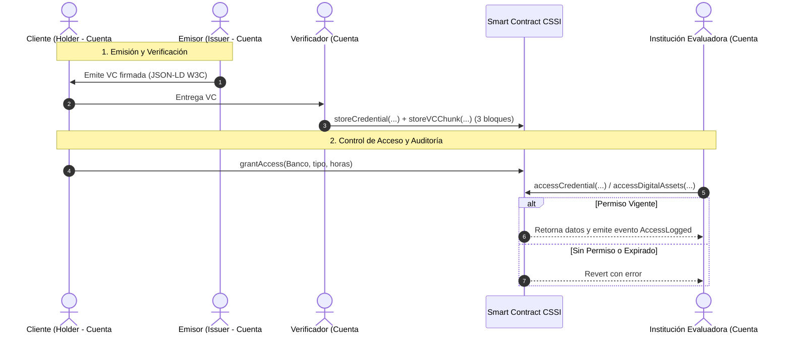

# CSSI: Self-Sovereign Identity Blockchain Framework

Implementación del prototipo propuesto en el artículo:

> **"A Self-Sovereign Identity Blockchain Framework for Access Control and Transparency in Financial Institutions"**  
> Hsia-Hung Ou, Guan-Yu Chen, Iuon-Chang Lin. *Cryptography* 2025, 9(1), 9.  
> DOI: [10.3390/cryptography9010009](https://doi.org/10.3390/cryptography9010009)

---

## Alcance respecto al paper

Se implementó lo que el artículo muestra en su Sección 4: páginas de titular, emisor y verificador; emisión de VC JSON-LD; verificación y registro por el verificador, con división del VC en fragmentos; activos digitales vía MetaMask; y los Algoritmos 1 y 2 (con la condición temporal del Algoritmo 2 corregida a block.timestamp <= until, pues el pseudocódigo original está invertido). Diferencias: la verificación usa una firma ECDSA del emisor en lugar de zk-SNARK, que el paper no muestra implementado; el did:ethr: es solo un identificador, sin registro de DIDs.

---

## ¿Cómo funciona el proyecto?

El sistema elimina intermediarios centralizados al intercambiar datos financieros y crediticios entre bancos, dejando el control en manos del usuario mediante un smart contract (`CSSI.sol`) y firmas criptográficas con MetaMask:

1. **Emisión de la Credencial (Issuer):**  
   El emisor (por ejemplo, `BancoX`) genera un JSON con la estructura W3C Verifiable Credential que contiene claims desidentificados (como balance o puntaje crediticio, sin exponer números de cuenta). El emisor firma ese JSON con su clave privada en MetaMask (`signMessage`), creando una prueba criptográfica `EcdsaSecp256k1Signature2019`.

2. **Verificación y Registro on-chain (Verifier):**  
   El verificador recibe el VC y realiza tres validaciones:
   - Que el JSON no haya sido manipulado comparándolo contra el payload firmado.
   - Que la firma corresponda a la dirección declarada como `issuer` (`verifyMessage`).
   - Que el contrato tenga a esa dirección registrada como emisor confiable (`isIssuer`).  
   Una vez validado, ejecuta `storeCredential(...)` para guardar la metadata y el hash del VC, y luego divide el documento completo en 3 fragmentos que almacena individualmente en el contrato con `storeVCChunk(...)`.

3. **Control de Acceso del Titular (Algoritmo 1 - Holder):**  
   El cliente decide a qué institución evaluadora le comparte información (`asset_info`, `credit_info` o `digital_assets`) y por cuántas horas. Llama a `grantAccess(institución, tipo, horas)`. Si cambia de opinión, revoca el permiso inmediatamente con `revokeAccess(...)`. Además, puede registrar direcciones de sus billeteras o NFTs con `addDigitalAsset(...)`.  
   *(Nota: el contrato registra la dirección provista para activos digitales pero no valida criptográficamente que pertenezca al titular).*

4. **Consulta y Auditoría (Algoritmo 2 - Evaluador):**  
   La institución evaluadora solicita los datos con `accessCredential(...)` o `accessDigitalAssets(...)`. El contrato comprueba:
   - Que la credencial exista (`issuedAt != 0`).
   - Que el cliente haya otorgado permiso a la dirección que consulta (`until != 0`).
   - Que el permiso no haya caducado (`block.timestamp <= until`).  
   Si se cumplen las 3 condiciones, entrega los datos y emite el evento `AccessLogged` en la blockchain, dejando un registro inalterable de quién consultó la información. Si alguna condición falla, revierte la transacción.



---

## Cuentas de Hardhat para MetaMask

El nodo local de Hardhat genera cuentas de prueba prefinanciadas con 10000 ETH.

> **Importante:** Estas claves privadas son públicas por defecto en Hardhat. **Úsalas únicamente en tu red local de desarrollo**, nunca en redes públicas ni con fondos reales.

Importa estas 4 cuentas en MetaMask usando sus claves privadas:

| Rol | Cuenta | Dirección | Clave Privada |
| :--- | :--- | :--- | :--- |
| **Emisor (Issuer)** | Cuenta #1 | `0x70997970C51812dc3A010C7d01b50e0d17dc79C8` | `0x59c6995e998f97a5a0044966f0945389dc9e86dae88c7a8412f4603b6b78690d` |
| **Verificador (Verifier)** | Cuenta #2 | `0x3C44CdDdB6a900fa2b585dd299e03d12FA4293BC` | `0x5de4111afa1a4b94908f83103eb1f1706367c2e68ca870fc3fb9a804cdab365a` |
| **Cliente (Holder)** | Cuenta #3 | `0x90F79bf6EB2c4f870365E785982E1f101E93b906` | `0x7c852118294e51e653712a81e05800f419141751be58f605c371e15141b007a6` |
| **Institución Financiera** | Cuenta #4 | `0x15d34AAf54267DB7D7c367839AAf71A00a2C6A65` | `0x47e179ec197488593b187f80a00eb0da91f1b9d0b13f8733639f19c30a34926a` |

---

## Comandos exactos para ejecutar en tu PC

Abre PowerShell en Windows y sigue estos pasos:

### 1. Iniciar la blockchain local
En la **Terminal 1**:
```powershell
cd C:\Users\USER\.gemini\antigravity\scratch\cssi
npx hardhat node
```
*Deja esta terminal abierta corriendo el nodo RPC en `http://127.0.0.1:8545`.*

### 2. Desplegar contrato, cargar datos y levantar frontend
En la **Terminal 2**:
```powershell
cd C:\Users\USER\.gemini\antigravity\scratch\cssi
npm run deploy
npm run seed
npm run serve
```
- `npm run deploy`: Compila `contracts/CSSI.sol`, lo despliega y genera `frontend/address.json`.
- `npm run seed`: Registra las credenciales iniciales de prueba de BancoX y BuroY.
- `npm run serve`: Levanta el servidor estático en **`http://localhost:3000`**.

---

## Configurar MetaMask en el Navegador

1. Abre MetaMask y agrega una red manual:
   - **Nombre de red:** `Hardhat Local`
   - **URL de RPC:** `http://127.0.0.1:8545`
   - **Identificador de cadena (Chain ID):** `31337`
   - **Símbolo de divisa:** `ETH`
2. Importa las cuentas #1, #2, #3 y #4 con las claves privadas de la tabla anterior.
3. *Tip si reinicias el nodo:* Ve a **MetaMask > Configuración > Avanzado > Borrar datos de actividad y de nonce** para limpiar los contadores locales.

---

## Paso a paso para probar el flujo completo

Abre **`http://localhost:3000`** en tu navegador:

### Paso 1: Emitir credencial (Cuenta #1 - Emisor)
1. Conecta MetaMask con la **Cuenta #1** (`0x7099...`).
2. En la sección **0A. Emisor (Issuer)**, deja los valores por defecto (Cliente: `0x90F7...`, BancoX, `CN-ASSET-001`).
3. Haz clic en **Emitir y firmar VC** y confirma la firma en MetaMask.
4. Pulsa **Entregar VC al verificador** (copia automáticamente el resultado al Verificador).

### Paso 2: Verificar y subir en fragmentos (Cuenta #2 - Verificador)
1. Cambia en MetaMask a la **Cuenta #2** (`0x3C44...`).
2. En la sección **0B. Verificador (Verifier)**, pulsa **Verificar y registrar en blockchain**.
3. Confirma las transacciones en MetaMask: se valida la firma, se registra la credencial y se suben los 3 fragmentos on-chain (`VC upload success`).

### Paso 3: Registrar activos digitales (Cuenta #3 - Cliente)
1. Cambia en MetaMask a la **Cuenta #3** (`0x90F7...`).
2. En la sección **1. Cliente (Holder)**, haz clic en **Obtener dirección desde MetaMask** para cargar tu dirección activa en el campo.
3. Pulsa **Registrar activo en blockchain** y confirma la transacción.

### Paso 4: Autorizar acceso (Cuenta #3 - Cliente)
1. En la misma sección del Cliente, pon la dirección de la entidad financiera:
   `0x15d34AAf54267DB7D7c367839AAf71A00a2C6A65`
2. Selecciona `Información de activos (asset_info)`.
3. Ingresa `2` horas y pulsa **Autorizar acceso**.

### Paso 5: Consultar datos y verificar auditoría (Cuenta #4 - Institución)
1. Cambia en MetaMask a la **Cuenta #4** (`0x15d3...`).
2. En la sección **2. Entidad Financiera**, escribe la dirección del cliente:
   `0x90F79bf6EB2c4f870365E785982E1f101E93b906`
3. Selecciona `asset_info` y pulsa **Consultar credencial**.
4. La información se mostrará en pantalla y se confirmará la transacción on-chain que emite el evento `AccessLogged`.

### Paso 6: Probar casos de rechazo y revocación
- **Sin permiso:** Estando en la Cuenta #4, intenta consultar `credit_info`. El contrato rechazará con `Customer does not allow`.
- **Revocación:** Cambia a la Cuenta #3 (Cliente), selecciona `asset_info` y pulsa **Revocar acceso**. Al intentar consultar con la Cuenta #4, el acceso será rechazado.
- **Expiración temporal:** Autoriza por 1 hora y en la terminal ejecuta:
  ```powershell
  cd C:\Users\USER\.gemini\antigravity\scratch\cssi
  npm run advance
  ```
  Esto adelanta el reloj de la EVM 3601 segundos. Al consultar con la Cuenta #4, el contrato revertirá con `The access period is expired`.

---

## Pruebas automatizadas

Para correr la suite de pruebas unitarias en Mocha/Chai:

```powershell
cd C:\Users\USER\.gemini\antigravity\scratch\cssi
npx hardhat test
```

Valida:
- Acceso autorizado vigente.
- Rechazo si el cliente no autorizó.
- Rechazo inmediato tras revocación.
- Rechazo al expirar el tiempo concedido.
- Rechazo si la credencial no existe.
- Rechazo a no verificadores o emisores desconocidos en `storeCredential`.
- Almacenamiento, conteo y lectura de fragmentos con `storeVCChunk`.
- Reensamblado de fragmentos y validación de hash exacto contra `vcHash`.
- Disparo del evento `AccessLogged` al consultar activos digitales.

---

## Ubicación exacta de archivos en tu PC

Todos los archivos del proyecto se encuentran en:
`C:\Users\USER\.gemini\antigravity\scratch\cssi`

- **Contrato inteligente:**
  `C:\Users\USER\.gemini\antigravity\scratch\cssi\contracts\CSSI.sol`
- **Frontend web:**
  `C:\Users\USER\.gemini\antigravity\scratch\cssi\frontend\index.html`
- **Dirección del contrato desplegado:**
  `C:\Users\USER\.gemini\antigravity\scratch\cssi\frontend\address.json`
- **Scripts:**
  - Despliegue y configuración de roles: `C:\Users\USER\.gemini\antigravity\scratch\cssi\scripts\deploy.js`
  - Carga inicial de credenciales: `C:\Users\USER\.gemini\antigravity\scratch\cssi\scripts\seed.js`
  - Utilidades criptográficas W3C: `C:\Users\USER\.gemini\antigravity\scratch\cssi\scripts\vc.js`
  - Avance de tiempo para expiración: `C:\Users\USER\.gemini\antigravity\scratch\cssi\scripts\advance-time.js`
- **Pruebas unitarias:**
  `C:\Users\USER\.gemini\antigravity\scratch\cssi\test\cssi.js`
- **Configuración de compilación:**
  `C:\Users\USER\.gemini\antigravity\scratch\cssi\hardhat.config.js`
