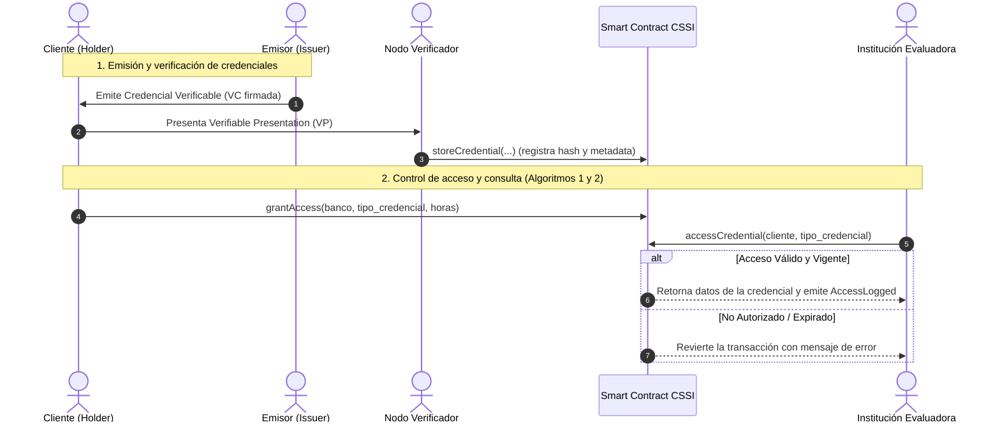

# CSSI: Self-Sovereign Identity Blockchain Framework

Implementación del prototipo propuesto en el artículo de investigación:

> **"A Self-Sovereign Identity Blockchain Framework for Access Control and Transparency in Financial Institutions"**  
> Hsia-Hung Ou, Guan-Yu Chen, Iuon-Chang Lin. *Cryptography* 2025, 9(1), 9.  
> DOI: [10.3390/cryptography9010009](https://doi.org/10.3390/cryptography9010009)

---

## Descripción del Proyecto

El framework CSSI (Customer Self-Sovereign Identity) aborda la problemática del intercambio de información financiera y crediticia entre instituciones sin depender de intermediarios centralizados. A través de Identidad Autosoberana (SSI) y contratos inteligentes en Ethereum, el cliente mantiene el control total de sus datos:

- **Desidentificación:** La información se desvincula de identificadores directos (como números de cuenta bancaria) empleando el nombre de la institución emisora (`F_name`) y un número de certificado (`CN`).
- **Control granular de acceso:** El titular autoriza de forma selectiva qué tipo de información comparte (`asset_info`, `credit_info` o activos digitales), con qué institución y por un periodo delimitado en horas.
- **Activos tradicionales y digitales:** Integra tanto credenciales de instituciones bancarias/burós como direcciones de activos digitales (criptomonedas y NFTs).
- **Auditoría inmutable:** Cada lectura exitosa por parte de una entidad evaluadora queda registrada en la blockchain mediante el evento `AccessLogged`.

### Flujo del Sistema



---

## Componentes Técnicos

- **Solidity (^0.8.24):** Implementación de la lógica de acceso de los Algoritmos 1 y 2 del paper (`contracts/CSSI.sol`).
- **Hardhat:** Entorno de compilación, simulación de blockchain local y ejecución de pruebas.
- **Ethers.js (v6):** Interacción con el smart contract y gestión de firmas con MetaMask.
- **W3C Verifiable Credentials:** Estructura JSON-LD para emisión y verificación criptográfica off-chain antes del registro on-chain (`scripts/vc.js`).

---

## Requisitos Previos

- **Node.js** (versión 18 o superior) y **npm**.
- Extensión **MetaMask** instalada en el navegador.

---

## Instalación y Ejecución

### 1. Iniciar la red local de Hardhat
En una primera terminal:
```bash
npx hardhat node
```
Esto iniciará un nodo Ethereum local en `http://127.0.0.1:8545` con 20 cuentas prefinanciadas con ETH de prueba. Mantén esta terminal abierta.

### 2. Desplegar el contrato y registrar credenciales de prueba
En una segunda terminal:
```bash
npm run deploy
npm run seed
```
- `npm run deploy`: Compila el contrato, lo despliega en la red local y guarda la dirección resultante en `frontend/address.json`.
- `npm run seed`: Emite y verifica dos credenciales W3C (`BancoX` con activos y `BuroY` con historial crediticio) y las registra en el contrato.

### 3. Iniciar el servidor web
En la misma terminal:
```bash
npm run serve
```
Abre en el navegador: **`http://localhost:3000`**.

---

## Configuración de MetaMask

1. **Agregar red local:**
   - **Nombre de red:** `Hardhat Local`
   - **URL de RPC:** `http://127.0.0.1:8545`
   - **Chain ID:** `31337`
   - **Símbolo de divisa:** `ETH`

2. **Cuentas de prueba preconfiguradas:**
   Importa mediante clave privada las siguientes cuentas generadas por el nodo:
   - **Cuenta #3 - Cliente (Holder):**
     - Dirección: `0x90F79bf6EB2c4f870365E785982E1f101E93b906`
     - Clave privada: `0x7c852118294e51e653712a81e05800f419141751be58f605c371e15141b007a6`
   - **Cuenta #4 - Institución Financiera (Evaluador):**
     - Dirección: `0x15d34AAf54267DB7D7c367839AAf71A00a2C6A65`
     - Clave privada: `0x47e179ec197488593b187f80a00eb0da91f1b9d0b13f8733639f19c30a34926a`

> **Nota:** Si reinicias el nodo de Hardhat, las cuentas en la blockchain volverán al nonce 0. Para evitar desajustes de sincronización en MetaMask, ve a **Configuración > Avanzado > Borrar datos de actividad y de nonce** antes de enviar nuevas transacciones.

---

## Pruebas de Funcionamiento

### 1. Autorización y consulta exitosa (Algoritmos 1 y 2)
1. Conecta MetaMask con la cuenta del **Cliente** (`0x90F7...`).
2. En la sección de cliente, ingresa la dirección de la institución (`0x15d34AAf54267DB7D7c367839AAf71A00a2C6A65`), selecciona `asset_info`, define 2 horas de validez y haz clic en **Autorizar acceso**.
3. Cambia en MetaMask a la cuenta de la **Institución Financiera** (`0x15d3...`).
4. Ingresa la dirección del cliente (`0x90F79bf6EB2c4f870365E785982E1f101E93b906`), selecciona `asset_info` y pulsa **Consultar credencial**. La información se desplegará en pantalla y se emitirá el evento de auditoría on-chain.

### 2. Acceso denegado por falta de autorización
- Con la cuenta de la Institución seleccionada, intenta consultar `credit_info` para el mismo cliente.
- El contrato revertirá la operación con el error `Customer does not allow`.

### 3. Revocación de acceso
- Con la cuenta del Cliente, haz clic en **Revocar acceso** para `asset_info`.
- Al consultar nuevamente desde la cuenta de la Institución, el acceso será rechazado.

### 4. Expiración temporal
- Concede acceso por 1 hora y ejecuta en la terminal:
  ```bash
  npm run advance
  ```
  Esto adelanta el timestamp de la máquina virtual de Ethereum en 3601 segundos. Al consultar de nuevo, el contrato devolverá `The access period is expired`.

---

## Pruebas Unitarias

El proyecto incluye pruebas automatizadas en Mocha/Chai para validar la lógica del smart contract:

```bash
npx hardhat test
```

Casos cubiertos:
- Consulta permitida bajo autorización activa.
- Rechazo cuando el cliente no ha autorizado el acceso.
- Rechazo inmediato posterior a una revocación.
- Rechazo automático al superar el tiempo de validez (`block.timestamp > until`).
- Validación de existencia previa de la credencial antes de conceder permisos.

---

## Estructura del Repositorio

```text
├── contracts/
│   └── CSSI.sol               # Smart contract principal (control de acceso y registro)
├── scripts/
│   ├── deploy.js              # Script de despliegue del contrato
│   ├── vc.js                  # Utilidades criptográficas para VCs (firma y verificación W3C)
│   ├── seed.js                # Emisión y almacenamiento inicial de credenciales de prueba
│   └── advance-time.js        # Utilidad para avanzar el timestamp en la red de pruebas
├── test/
│   └── cssi.js                # Pruebas unitarias de las funciones del contrato
├── frontend/
│   ├── index.html             # Interfaz web de usuario (cliente e institución)
│   └── address.json           # Dirección del contrato desplegado
├── hardhat.config.js          # Configuración de red y compilador de Hardhat
└── package.json               # Dependencias y scripts del proyecto
```
